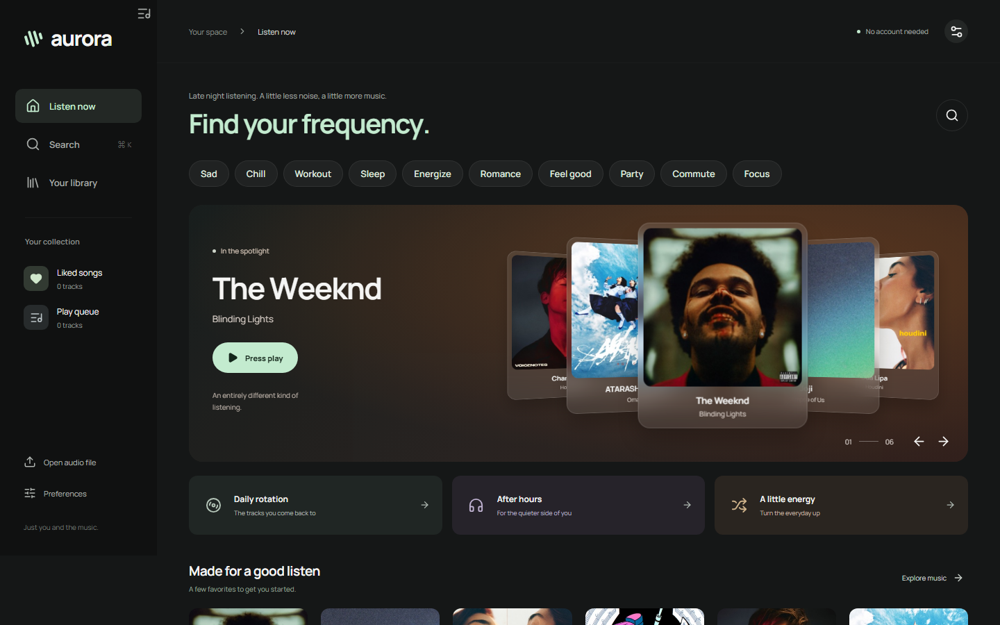

# Aurora Player

A music player for the browser. Artwork-led interface, search across several catalogs, synchronized lyrics with word-level timing, a queue and local favorites. No account needed.

[Live app](https://aurora-player-seven.vercel.app) | [Feature reference](docs/FEATURES.md)



## Features

**Search.** Songs and albums come from iTunes, artists from Deezer, videos and playlists from YouTube. The top result follows the intent of the query.

**Lyrics.** Several providers are queried at once (BetterLyrics, LyricsPlus, LRCLib, KuGou, NetEase and others). Real word timing is preferred, then line timing, then plain text. Timing is never generated. You can shift it by hand in 0.1 s steps, and the offset is remembered per song.

**Playback.** Online tracks play through the YouTube IFrame player. Local audio files play directly in the browser at their real format (for example FLAC 24-bit/96 kHz) and are never uploaded.

**DJ mode.** Beat-aligned transitions with tempo matching between songs, pitch preserved. Details in [docs/DJ-TRANSITION.md](docs/DJ-TRANSITION.md).

**Local by default.** Favorites, history and recommendations stay in local storage. The app installs as a PWA and caches its shell; catalog, YouTube and lyric requests still need a connection.

## Keyboard

| Key | Action |
|---|---|
| `Space` | Play / pause |
| `Left` `Right` | Seek 5 s |
| `Shift` + `Left` `Right` | Previous / next track |
| `L` | Lyrics |
| `F` | Favorite |
| `M` | Mute |
| `I` | Lyrics focus |
| `/` or `Ctrl` + `K` | Search |
| `Esc` | Step back one layer |

## Development

```sh
npm ci
npm run dev -- --port 5187   # serves the same /api handlers used on Vercel
npm run lint
npm test
npm run build
```

## Stack

React 19, Vite, Motion, Lenis, Calligraph. API handlers in `api/` run as Vercel serverless functions. The repository root is the Vercel app (`npm run build`, output `dist`); `web/` only holds a redirect for the former landing deployment.

## Documentation

[Architecture](docs/ARCHITECTURE.md) | [DJ transitions](docs/DJ-TRANSITION.md) | [Live tests](docs/LIVE-TESTS.md) | [Performance audit](docs/PERFORMANCE-AUDIT.md)

## Credits

[BitChord](https://github.com/kushagrasinghx/BitChord) informed the lyrics-provider research. The adapters and renderer here are independent implementations and no GPL code was copied. Music, cover art and lyrics belong to their rights holders. Streaming availability and audio quality are controlled by the source.

MIT for the Aurora source. Third-party packages keep their own licenses.