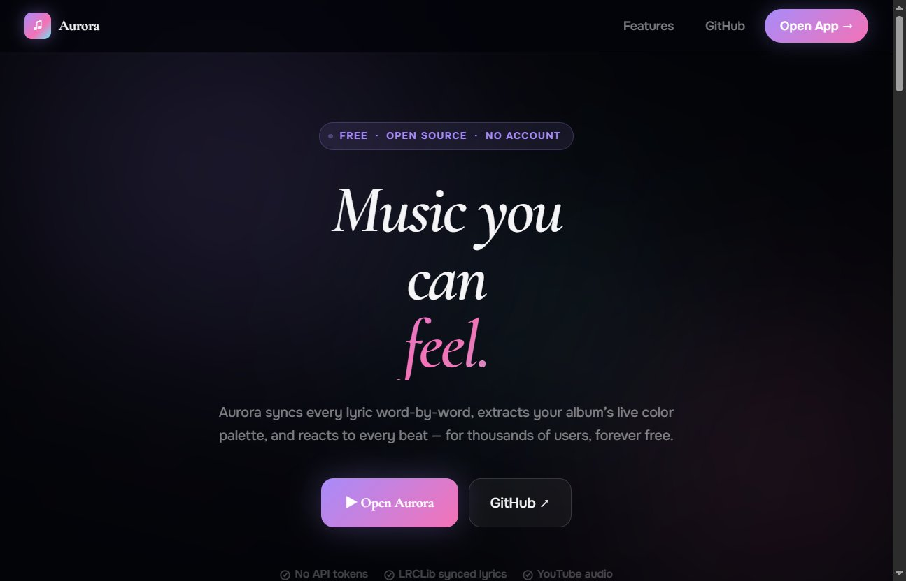

<div align="center">



<br>

[](https://aurora-player-tpainn.vercel.app)


**A music player where the artwork leads, the lyrics move word by word, and the room breathes on the beat.**

</div>

<br>



## Why it feels different

| | |
|---|---|
| **Karaoke-grade lyrics** | Seven lyric sources race each other. Genuine word timing wins, then line timing, then plain text. Timing is never faked, and you can nudge it by hand in 0.1 s steps. |
| **Beat-reactive visuals** | Refrains, held notes and replayed sections light up the artwork. When tempo is known, the whole background breathes on the beat. |
| **A real DJ blend** | Beat-aligned crossfades with tempo matching, bass swap and echo tail on local files. Pitch is preserved. |
| **Everything in one search** | Songs and albums from iTunes, artists from Deezer, videos and playlists from YouTube, with a top result that follows intent. |
| **Your files, untouched** | Device audio plays through a direct path at its real format (FLAC 24-bit/96 kHz and up). Nothing is uploaded. |
| **No account, no ads of its own** | Favorites, history and recommendations live in local storage. |

## Quick start

```sh
npm ci
npm run dev -- --port 5187   # app + the same /api handlers used on Vercel
```

```sh
npm run lint
npm test
npm run build
npm run preview -- --port 5188
```

## Keyboard

`Space` play/pause · `←` `→` seek 5 s · `Shift+←` `Shift+→` previous/next · `L` lyrics · `F` favorite · `M` mute · `I` lyrics focus · `/` or `Ctrl+K` search · `Esc` step back

## Stack

| Layer | Tech |
|---|---|
| UI | React 19, Vite, Framer Motion / Motion, Lenis smooth scroll, Calligraph |
| Data | iTunes, Deezer, YouTube IFrame + Innertube, 7 lyric providers |
| API | Vercel serverless handlers (`api/`), optional legacy `server/` |
| Delivery | Installable PWA with an offline application shell |

## Deploy

The repository root is the Vercel Vite app (`npm run build`, output `dist`). `web/` holds the redirect for the former landing deployment. Opt-in diagnostics: open `/?audit=1` and read `#aurora-audit` (stays in the page, never sent anywhere).

## Docs

[Feature deep dive](docs/FEATURES.md) · [Architecture](docs/ARCHITECTURE.md) · [DJ transitions](docs/DJ-TRANSITION.md) · [Live tests](docs/LIVE-TESTS.md) · [Performance audit](docs/PERFORMANCE-AUDIT.md) · [Design](DESIGN.md) · [Product scope](PRODUCT.md)

## Credits & legal

[BitChord](https://github.com/kushagrasinghx/BitChord) informed the lyrics-provider research; Aurora's adapters and renderer are independent implementations and no GPL code was copied. Music, cover art and lyrics remain the property of their rights holders. Streaming availability and audio quality are controlled by the source.

MIT for Aurora source; third-party packages keep their own licenses.

<div align="center"><sub>Built by <a href="https://github.com/TPAINN">Apostolos Peiniris</a></sub></div>